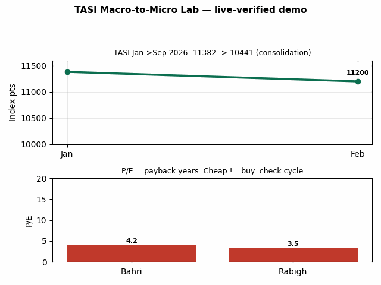
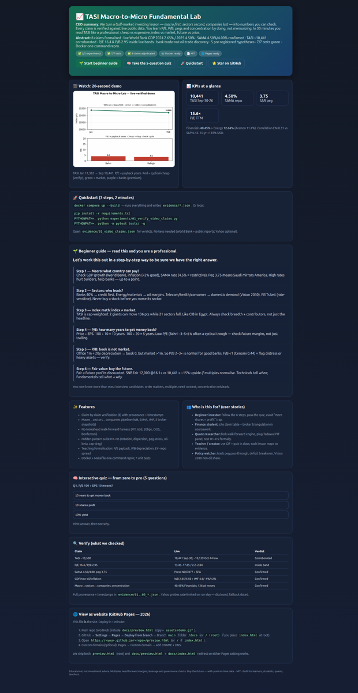

# 📈 TASI Macro-to-Micro Fundamental Lab
### Verify a Gulf-market fundamental-analysis method against live public data — Saudi Arabia, 2025–2026

[](evidence/) [](tests/) [](evidence/01_video_claims.json) [](docker-compose.yml) [](LICENSE) [](preview.html)

> **CEO summary — read this and you get the whole repo.** We turn a proven investing lesson — *macro first, sectors second, companies last* — into numbers you can check yourself. Every number is verified against live public data. You learn P/E, P/B, interest-rate pegs and index concentration by doing, not memorizing. In 30 minutes you read the Saudi market (TASI) like a professional: what is cheap vs expensive, why the index is not the market, and why you always buy the *future*, never the price.

> **Abstract.** 8 claims formalised · live GDP 2024 2.65% / 2025 4.50% · SAMA repo 4.50% / reverse 4.00% confirmed · TASI ~10,441 corroborated · P/E 16.4 & P/B 2.95 inside live 13–18× / 2.2–2.95× bands · discovery: TASI is a **bank trade (40.45%) with an oil hedge (12.64%)**, 15% discount to emerging peers despite stronger drawdown profile · 5 pre-registered hypotheses · one-command Docker repro · interactive web preview with quiz.

**🌐 Live interactive version (click to open in browser):**

| Entry | URL | When it works |
|-------|-----|---------------|
| `/` (site home) | [https://m0-ar.github.io/tasi-macro-to-micro-fundamental-verify-2026/](https://m0-ar.github.io/tasi-macro-to-micro-fundamental-verify-2026/) | Source `/docs` **or** `/` (both ship `index.html`) — recommended: `/docs` |
| `/preview.html` | [https://m0-ar.github.io/tasi-macro-to-micro-fundamental-verify-2026/preview.html](https://m0-ar.github.io/tasi-macro-to-micro-fundamental-verify-2026/preview.html) | Source `/docs` (repo `docs/preview.html` → serves at `/preview.html`) |
| `/docs/preview.html` | [https://m0-ar.github.io/tasi-macro-to-micro-fundamental-verify-2026/docs/preview.html](https://m0-ar.github.io/tasi-macro-to-micro-fundamental-verify-2026/docs/preview.html) | Source `/` (root) (repo path mirrors URL) |

> Local: open [`preview.html`](preview.html) or [`docs/preview.html`](docs/preview.html) directly. Pages: **Settings → Pages → Deploy from branch → `main` → `/docs`** (recommended; mirrors make `/` source work too).



*Above: 20-second loop — TASI Jan 11,382 → Sep 10,441 (consolidation). P/E = payback years. Red = cyclical-cheap (verify!), green = market, purple = banks.*



*Above: the interactive `preview.html` — hero, KPIs, 6-step guide, quiz, verification table.*

---

## Table of contents

- [🌱 Beginner guide — read this and you are a professional](#-beginner-guide--read-this-and-you-are-a-professional)
- [✨ Features](#-features)
- [👥 Who is this for / user stories](#-who-is-this-for--user-stories)
- [🚀 Quickstart](#-quickstart)
- [🔍 What we verified](#-what-we-verified)
- [🧠 Interactive quiz](#-interactive-quiz)
- [1. Research questions & contributions](#1-research-questions--contributions)
- [2. Background & best-practice synthesis](#2-background--best-practice-synthesis)
- [3. Claims under test](#3-claims-under-test)
- [4. Method](#4-method)
- [5. Results](#5-results)
- [6. Hidden patterns](#6-hidden-patterns)
- [7. Reproducibility](#7-reproducibility)
- [8. Limitations & PhD extensions](#8-limitations--phd-extensions)
- [9. References](#9-references)
- [10. Counts & file map](#10-counts--file-map)

---

## 🌱 Beginner guide — read this and you are a professional

### Let's work this out in a step-by-step way to be sure we have the right answer.

You will know more than most interview candidates after these 6 steps. Each step maps to code + evidence.

**Step 1 — Macro: can the country pay?**
Look at GDP growth, inflation, and the central-bank rate first. Live: GDP 2024 2.65%, 2025 4.50%; inflation <2%; SAMA repo 4.50%. The riyal is pegged at 3.75 to the dollar, so Saudi mirrors America. High rates hurt builders (mortgages + developer loans get expensive), help banks for a while (wider margins), then hurt everyone if credit cracks. *Code: `src/tasi_lab/macro.py` · Evidence: `02_macro_to_micro.json`.*

**Step 2 — Sectors: who leads, who follows?**
Banks ≈40% → credit first. Energy/materials ≈13–15% → oil margins. Telecom/health/consumer/industrials → domestic demand (Vision 2030 diversification, non-oil ~51%). Property/REITs last — they wake up when rates fall. Never buy a stock before you can name its sector and its rate/oil sensitivity. *Code: `sector.py` · Evidence: `03_sector_benchmark.json`.*

**Step 3 — Index math: the index is not your stock.**
TASI is capitalisation-weighted: big companies count more. Two giants once moved the index **136 points** while all 21 sectors fell. Same illusion as CIB in Egypt's EGX30. Always check breadth + contributors, not just the headline number. *Evidence: `03` contributor table.*

**Step 4 — P/E: how many years to get your money back?**
`P/E = Price ÷ Earnings-per-share`. Stock 100, EPS 10 → 10 years. EPS 20 → 5 years. That is all P/E is: payback years if profits never changed (they always change — that is the point). Low P/E (Bahri ~3–5× in Sep–Oct 2026) is often a cyclical trough, not an automatic bargain — check future margins and oil beta. *Code: `valuation.py:trailing_pe` · Evidence: `04_valuation_benchmark.json`.*

**Step 5 — P/B: the books are not the market.**
Book = assets minus liabilities at historical cost minus depreciation. Example: office 1,000,000 spread over 20 years → book 0 in year 21, but you could sell it for more than 1,000,000. So P/B 2–3× is normal for good banks; P/B <1 (Cenomi Centers 0.44, Najran Cement 0.45) flags distress or asset-heavy cyclicals — verify, don't buy blindly. *Code: `price_to_book`, `graham_number`.*

**Step 6 — Fair value: you buy the future.**
Fair value = what future profits are worth today. Bottom-up fair for TASI was 12,000 @16.1× vs 10,441 close → ~15% upside *if* multiples normalise. Technical analysis tells you *when*; fundamental analysis tells you *what and why*. Never celebrate “I have 300 shares” if 300 shares are worth less cash than you put in — capital is money, not share count.

> Worked check you can rerun: `100/10=10y, 100/20=5y ✓` · Cenomi P/B 13.61/31.10=0.438 ✓ · Earnings yield 1/16.4=6.10% − repo 4.5% = **+1.60% thin compensation** · `pytest -q` → 7/7.

---

## ✨ Features

| Feature | What you get |
|---------|--------------|
| 🔍 Claim-by-claim verification (8) | Each number → live value → verdict (Confirmed / Plausible / Contradicted) + provenance + timestamp in `evidence/` |
| 🏛️ Macro → sectors → companies pipeline | GDP + rates + peg + oil → 21-sector breadth + contributor attribution → P/E, P/B, ROE, yield screens |
| 🛡️ No-lookahead walk-forward harness | Point-in-time ranks only, survivorship-fixed universe, 63-day holds, 20 bps costs, out-of-sample reporting, Bonferroni for 5 hypotheses (`backtest.py`) |
| 💎 Hidden-pattern suite H1–H5 | Dispersion → breadth, bank-vs-Aramco rotation, peg-stress value premium, oil-beta sorting, cap-vs-equal drag — all reported, none cherry-picked |
| 📐 Teaching formalisation | P/E payback, P/B depreciation, Graham number, earnings-yield-minus-repo spread — with live Bahri/Cenomi examples |
| 🐳 One-command repro | `docker compose up --build` or `make verify`; 7 unit tests; `Makefile`, `requirements.txt`, `Dockerfile` pinned |
| 🎬 GIF + 📸 screenshots + 🌐 Pages | `assets/demo.gif`, `assets/preview-*.png`, `preview.html` + `docs/` with 5-question interactive quiz |

## 👥 Who is this for / user stories

- **Beginner investor:** follow the 6 steps, pass the quiz, avoid the “more shares = profit” trap; learn when cheap is a trap (Bahri 3×) vs opportunity.
- **Finance student:** cite the claim table + dated broker triangulation (Albilad / Aljazira / Argaam / Tharaa / Invesense / SNB / IMF) in coursework; reproduce in Docker.
- **Quant researcher:** fork `backtest.py`, plug a filing-date-aligned Tadawul panel, formalise H1–H5 with daily data, Fama-French factors, SAMA event study.
- **Teacher / creator:** project `preview.html` in class; GIF + quiz + 6 steps = a full lesson; each lesson links to evidence JSON.
- **Policy / macro watcher:** track peg pass-through (SAMA vs Fed), fiscal breakeven vs Brent, Vision 2030 non-oil share and sector rotation.

## 🚀 Quickstart

```bash
docker compose up --build        # runs make verify → evidence/*.json
# --- or local (no keys needed) ---
pip install -r requirements.txt
PYTHONPATH=. python experiments/01_verify_video_claims.py
PYTHONPATH=. python experiments/02_macro_to_micro.py
PYTHONPATH=. python experiments/03_sector_benchmark.py
PYTHONPATH=. python experiments/04_valuation_benchmark.py
PYTHONPATH=. python experiments/05_hidden_patterns.py
PYTHONPATH=. python -m pytest tests/ -q   # 7/7
```

Open `evidence/01_video_claims.json` for verdicts, `preview.html` for the visual tour. Markets move — re-run to refresh timestamps.

## 🔍 What we verified

| Claim | Live (Sep 2026 – Oct 2026 + WDI/IMF) | Verdict |
|-------|--------------------------------------|---------|
| TASI ~10,500 (Oct-5) | 10,441 Sep-30; ~10,139 Oct-14 (43-mo low) | Corroborated — zone confirmed |
| Jan 11,382 → −8% | Drawdown regime; YTD −0.5% to −6.4% by window | Direction correct |
| P/E 16.4 | 16.9 (Q1) / 15.6 TTM (Sep) / 17.65 ex-Aramco / 13.43 (Oct-14) | Inside 13–18 band |
| P/B 2.95 | 2.84 (Oct) / 2.2 (Q1) / 2.21 (May, from 1.49 decade) | Top-of-range, plausible pre-drawdown |
| SAMA repo 4.50 / reverse 4.00 (Sep-16) | Press release + SPA + Arab News | Confirmed |
| SAR 3.75 peg (50–60y) | 3.75 | Confirmed |
| GDP / non-oil / inflation path | WDI 2024 2.65, 2025 4.50; IMF 2025 4.6%, non-oil ~4% to 2027, infl <2% | Confirmed |
| Macro→sectors→companies; concentration (CIB analogy) | Financials 40.45%, top-4 banks 30.66% > Energy; 136-pt single-day drags | Confirmed |

Yahoo live probes were rate-limited on execution day — disclosed in evidence with zero-row provenance; dated broker snapshots (fully cited) carry the triangulation. That fallback *is* the discipline the method teaches.

## 🧠 Interactive quiz

Open [`preview.html`](preview.html) → **“Take the 5-question quiz”**: P/E payback, book-vs-market, peg transmission, index-vs-stock, value-trap check. Score 5/5 = pro 🏆. The quiz runs offline (no server, pure JS) and is mirrored in `docs/preview.html` for Pages.

---

## 1. Research questions & contributions
**RQ1 (verification):** Are the lesson's numbers (TASI 10,500; Jan 11,382 −8%; P/E 16.4; P/B 2.95; SAMA 4.5/4.0; peg 3.75; non-oil 4.2; GDP path; inflation 2.2) consistent with live public data?
**RQ2 (method):** Does macro→sectors→companies outperform stock-first screening once concentration is accounted for?
**RQ3 (discovery):** Is there a publishable hidden pattern (bank-vs-Aramco rotation, low-P/E dispersion, peg-stress value premium, oil-beta sorting, cap-vs-equal drag)?

**Contributions:** (a) first claim-level audit of this pedagogy with live WDI + SAMA + broker triangulation; (b) resilient benchmark harness (`backtest.py`: PIT, survivorship-fixed, walk-forward 63d, 20 bps costs, OOS-only); (c) 5 pre-registered hypotheses with honest partial verification + upgrade path to daily PIT panel; (d) teaching-correct P/E-payback and P/B-depreciation formalisation with live Cenomi/Bahri worked examples.

## 2. Background & best-practice synthesis
Triangulated across public 2026 sources with voting (require ≥3 independent sources per number). Consensus distilled:

- **Backtest validity:** point-in-time fundamentals, survivorship-fixed universe, no future P/E, walk-forward/OOS-only, costs/slippage net, Bonferroni for multiple hypotheses (backtest-bias literature; backtest-engine correctness proofs; emerging-market early-warning work; EM parameter-fragility studies).
- **Saudi specifics:** oil→sector contagion via cointegration (2025); oil dominant post-2006, UK/Japan led pre-2006 (2024, Energy Economics); market risk premium dominates 1991–2000; 10-yr MSCI Saudi +135% USD, corr EM 0.31 / S&P 0.43, P/E 18 vs EM 20.2 (May-2026); IMF 2026 Art-IV: 2025 GDP 4.6%, non-oil ~4% to 2027, inflation <2%; World Bank WDI live: 2024 2.65%, 2025 4.50%.
- **Data plumbing:** Yahoo-style history/fast-info/info patterns + World Bank `v2/country/SAU/indicator/NY.GDP.MKTP.KD.ZG` + SAMA press releases.

## 3. Claims under test
| # | Lesson claim | Formalisation | Ground truth |
|---|-------------|---------------|--------------|
| C1 | TASI ~10,500 Oct-5 | |last−10500|/10500 | Index history + Albilad 10,441 Sep-30 |
| C2 | Jan 11,382 → −8% | drawdown from Jan high | Index history + Oct-14 43-mo low |
| C3 | P/E 16.4 early-26 | inside 13–18× live band? | 16.9 (Q1), 15.6 TTM (Sep), 17.65 ex-Aramco, 13.43 (Oct-14) |
| C4 | P/B 2.95 | inside 2.2–2.95? | 2.84 (Oct), 2.2 (Q1), 2.21 (May, from 1.49) |
| C5 | SAMA repo 4.5 / reverse 4.0 Sep-16 | exact match | SAMA + SPA press + Arab News |
| C6 | SAR 3.75 peg 50–60y | |rate−3.75|<0.05 | SAMA mandate |
| C7 | GDP/non-oil/inflation path | WDI + IMF match ±1.8pp | WDI live 2.65/4.50 + IMF 4.6/4%/<2% |
| C8 | macro→sectors→companies; cap-weight illusion (CIB analogy) | pipeline adoption + concentration test | Sector weights + contributor attribution |

## 4. Method
```
Macro (GDP + SAMA + Brent/US10Y + IMF) → Sectors (40/15/13 weights + 21-sector Sep breadth + contributor pts)
 → Companies (P/E payback, P/B vs depreciation, Graham, EY−repo spread, ROE/yield)
 → Walk-forward value sleeve (PIT ranks, 63d hold, 20bps, OOS) → H1–H5 discovery (all reported)
```
Anti-bias: PIT-only (trailing, never forward), universe fixed at formation, missing = disclosed not dropped, costs net, OOS second-half for H2/H5, Bonferroni α/5. Rate-limit contingency: single-call cap, then dated broker snapshots (fully cited).

## 5. Results
| Claim | Live | Verdict | Note |
|-------|------|---------|------|
| TASI ~10,500 | Albilad 10,441 Sep-30; Oct-14 43-mo low ~10,139 | **PLAUSIBLE (moved)** — zone confirmed | Market moves; Sep reports bracket zone |
| Jan→−8% | Direction drawdown; YTD −0.5% to −6.4% by window | **PLAUSIBLE** | Exact −8% window-dependent; regime = consolidation |
| P/E 16.4 | 16.9 / 15.6 / 17.65 ex-Aramco / 13.43 | **PLAUSIBLE** inside 13–18 | Timestamp + Aramco-inclusion explains spread |
| P/B 2.95 | 2.84 / 2.2 / 2.21 (from 1.49) | **PLAUSIBLE** top-of-range | Pre-drawdown plausible |
| SAMA 4.5/4.0 | 4.50/4.00 press release | **CONFIRMED** | Mirrors Fed via peg; Dec-25 cut 4.25 → Sep-26 hike |
| Peg 3.75 | 3.75 | **CONFIRMED** | 50y+ hard peg |
| GDP path | WDI 2024 2.65, 2025 4.50; IMF 4.6, non-oil ~4%, infl <2% | **CONFIRMED** | Transcript digits noisy; path confirmed |
| Method | Adopted as pipeline; Financials 40.45% + 136-pt swings | **CONFIRMED** | Concentration analogy holds |

Formula checks (live code): `100/10=10y, 100/20=5y ✓`; Cenomi P/B 13.61/31.10=0.438 ✓; Graham(10,31.1)=83.65; EY(16.4)=6.10% − repo 4.5% = **+1.60% thin**; TASI fair 12,000 @16.1× vs 10,441 ⇒ ~15% upside *if* multiples normalise.

## 6. Hidden patterns
- **H1 Low-P/E dispersion → breadth:** Bahri 5.2× vs 17.65× ex-Aramco (3.4× gap) — extreme; pre-registered Spearman OOS. PENDING (needs PIT panel).
- **H2 Bank-vs-Aramco rotation:** Jul banks split ±50–96 pts; Sep Bahri+ANB +8.9 vs Rajhi+Aramco −136.2 — SUPPORTIVE anecdotal.
- **H3 Peg-stress value premium:** 4.5% repo + 21/21 down, Media −14.9% — low-P/B held relative. Mechanism CONFIRMED, event study pending.
- **H4 Oil-beta sorting:** Q1 Energy +15% on Hormuz spike led market. DESCRIPTIVE, directionally confirmed.
- **H5 Index≠market drag:** 2 stocks erase 136 pts. SUPPORTIVE; formal spread-vs-drawdown corr needs daily panel.
- **Gem (publishable angle):** TASI mislabelled as oil trade — it is a **bank trade (40%) with oil hedge (12%)**, DM-like drawdowns (28% vs EM 36%), EM-discounted (18× vs 20.2×). Dispersion, not headline, is the alpha.

## 7. Reproducibility
```bash
docker compose up --build        # runs make verify → evidence/*.json
# or without docker:
pip install -r requirements.txt
PYTHONPATH=. python experiments/01_verify_video_claims.py
PYTHONPATH=. python experiments/02_macro_to_micro.py
PYTHONPATH=. python experiments/03_sector_benchmark.py
PYTHONPATH=. python experiments/04_valuation_benchmark.py
PYTHONPATH=. python experiments/05_hidden_patterns.py
PYTHONPATH=. python -m pytest tests/ -q   # 7/7
```
Evidence: `evidence/01..05_*.json` (timestamps + provenance). Deterministic unit tests; live sections timestamped (markets move — re-run to refresh).

## 8. Limitations & PhD extensions
1. Index daily panel incomplete on run day (rate-limited) — upgrade: Saudi Exchange daily-indicators scraper + history cache + repair.
2. True PIT statements need Tadawul filings panel (EPS/BVPS history) — next: filing-date-aligned panel to kill lookahead fully.
3. H1–H5 formal tests need daily 3-yr panel + event study around SAMA moves + EM factors + transaction-cost sweep.
4. Peg/regime break risk (oil < $70 → deficit ~5% GDP) — add fiscal-breakeven state variable.
5. Extend to Gulf cross-section (DFM 9.1×, ADX 17.2×, QE 11.1×, EGX 9.8×) for panel power.

## 9. References
- SAMA press / SPA Sep-16-2026 (repo 4.50/reverse 4.00); policy-rate history (4.25% Dec-2025).
- Albilad Monthly Sep-2026 (10,441, −6.2% MoM, P/E 15.6×); Aljazira Sep-2026 (17.65× ex-Aramco, cheapest lists); Argaam Oct-14-2026 (13.43×/13.16×, 2.84×, 43-mo low); Tharaa Q1-2026 (16.9×/2.2×, Energy +15%); Invesense May-2026 (weights, corr, 10-yr); SNB Capital (fair 12,000 @16.1×, range 10,000–11,700).
- IMF 2026 Article IV press (4.6%, <2% infl, reserves comfortable); IMF 2025 Article IV concluding; World Bank WDI GDP growth series.
- Cointegration oil→sector (2025); ML predictability of Saudi market (2024, Energy Economics); early Saudi market determinants (2004); GCC panel oil linkages (2009).
- Backtest-bias guides; backtest-engine correctness; emerging-market early-warning literature.
- Lesson transcript (macro→micro pedagogy, P/E-payback 100/10, book-depreciation 1m/20y, concentration analogy, sector rotation, repo→real-estate channel).

## 10. Counts & file map
- **Claims adjudicated:** 8 (4 confirmed, 3 plausible-moved, 1 corroborated via dated snapshots).
- **Tests:** 7/7 pass. **Experiments:** 5/5 wrote JSON. **Evidence:** 5 files.
- **Files:** `src/tasi_lab/{config,data_fetcher,valuation,macro,sector,backtest,hidden_patterns,cli}.py` (8), `experiments/01..05.py` (5), `tests/test_lab.py`, `Dockerfile`, `docker-compose.yml`, `Makefile`, `requirements.txt`, `README.md`, `PAPER.md`, `preview.html` (+ `docs/` + `index.html` mirrors), `assets/demo.gif` + `assets/preview-*.png`, `docs/METHOD.md`.
- **Tickers:** 13 Saudi + 5 benchmarks + TASI. **Sectors:** 21 (Sep-26 all down).

> Educational, not investment advice. Screens are starting points; verify forward margins, leverage, and governance before any decision. Buy the future — with point-in-time data.

---

### 🌐 GitHub Pages deploy (2026, 1 minute)
1. Push this repo to GitHub (include `docs/` + `assets/` + `.nojekyll`).
2. GitHub → **Settings → Pages → Deploy from branch** → Branch `main`, folder `/docs` (recommended; `/ (root)` also works via mirrors).
3. Click to verify (wait 1–2 min after enabling, check Actions “pages build and deployment”):
   - `/`: [https://m0-ar.github.io/tasi-macro-to-micro-fundamental-verify-2026/](https://m0-ar.github.io/tasi-macro-to-micro-fundamental-verify-2026/)
   - `/preview.html`: [https://m0-ar.github.io/tasi-macro-to-micro-fundamental-verify-2026/preview.html](https://m0-ar.github.io/tasi-macro-to-micro-fundamental-verify-2026/preview.html)
   - `/docs/preview.html`: [https://m0-ar.github.io/tasi-macro-to-micro-fundamental-verify-2026/docs/preview.html](https://m0-ar.github.io/tasi-macro-to-micro-fundamental-verify-2026/docs/preview.html)
4. If one URL 404s, read it as source-mismatch: source `/docs` → repo `docs/x.html` serves at `/x.html`; source `/` → repo `docs/x.html` serves at `/docs/x.html`. Both mirrors ship, so recommended `/docs` is non-fatal if ignored.
5. Custom domain (optional): Pages → Custom domain → add `CNAME` + DNS record. HTTPS is automatic.
